<div align="center">

<picture>
  <source media="(prefers-color-scheme: dark)" srcset="resources/ledger-icon/svg/ledger-lockup-mark-dark.svg">
  
</picture>

<br>
<br>

**Your AI usage limits, credits and tokens for fourteen providers, one click away in the COSMIC panel.**

[](https://github.com/chefn3ff/cosmic-applet-ledger/actions/workflows/ci.yml)
[](https://github.com/chefn3ff/cosmic-applet-ledger/releases/latest)
[](LICENSE)

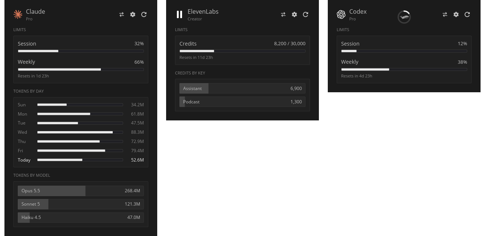

<sub>Screenshots use Ledger's built-in demo data.</sub>

</div>

---

Ledger sits in the COSMIC panel and shows how close you are to every AI limit you pay for: session and weekly windows, spend, credits and token use. It talks to each provider's own API with accounts you add in Ledger. No telemetry, no cloud sync, no third-party servers.

Ledger is built on [YapCap](https://github.com/TopiCsarno/yapcap) by Topi Csarno, whose provider engine, multi-account support and sign-in flows it keeps.

## What Ledger adds to YapCap

| Area | What changed |
| --- | --- |
|  **Redesign** | A flat, minimalist popup, settings and account screens, inspired by Omarchy |
|  **New providers** | OpenRouter, ElevenLabs and Fish Audio, on top of YapCap's eleven |
|  **Token charts** | **TOKENS BY DAY** (last seven days) and **TOKENS BY MODEL** for Claude and OpenRouter |
|  **Credits by key** | ElevenLabs credits split by API key for the current billing period |
|  **Credit rings** | An ElevenLabs or Fish Audio credit gauge in every other provider's header; click it to swap between the two |
|  **Hardening** | Credential files written atomically, a separate OAuth `state` for Claude sign-in, current TLS libraries, and clearer API-key errors |
|  **Sync** | Every setting change reaches every running Ledger process |

Full history: [CHANGELOG.md](CHANGELOG.md).

## Providers

| Provider | Sign in with | Shows |
| --- | --- | --- |
|  Antigravity | Google (browser) | 5-hour and weekly model-group quota |
|  Claude | Claude (browser) | Session and weekly limits, tokens by day and model |
|  Codex | OpenAI (browser) or OpenCode import | 5-hour and weekly limits |
|  Copilot | GitHub device login or OpenCode import | Chat and completions, or premium requests |
|  Cursor | The Cursor IDE's local sign-in | Total and API usage |
|  ElevenLabs | API key | Monthly credits, reset time, credits by key |
|  Fish Audio | API key | API credit left of what you have topped up |
|  Gemini | Google (browser), enable manually | Pro, Flash and Lite quota |
|  Grok | xAI (browser) or Grok CLI import | Weekly credit usage |
|  Kimi | API key | Weekly and rate-limit windows |
|  Minimax | API key | 5-hour and weekly windows |
| 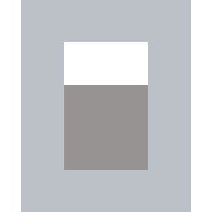 OpenCode Go | API key | 5-hour and weekly windows |
|  OpenRouter | API key | Daily and weekly spend, balance, tokens by day and model |
|  Z.AI Coding Plan | API key | 5-hour and weekly windows |

<details>
<summary><b>See every provider page</b></summary>
<br>
<p align="center">
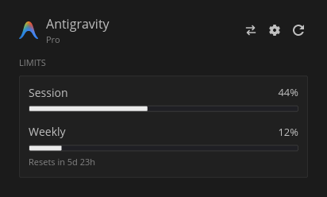
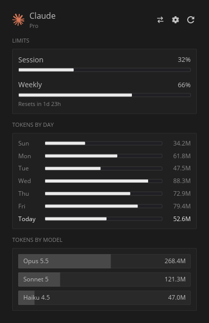
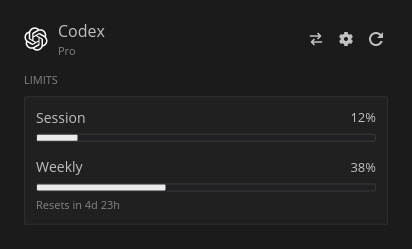
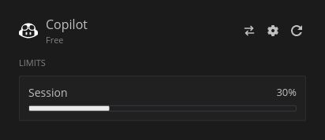
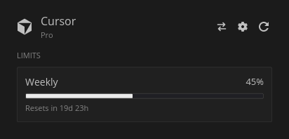
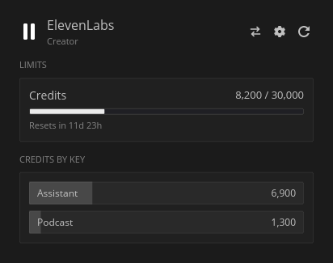
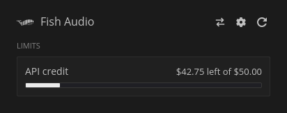
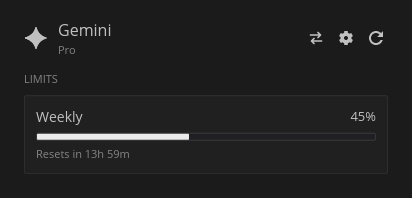
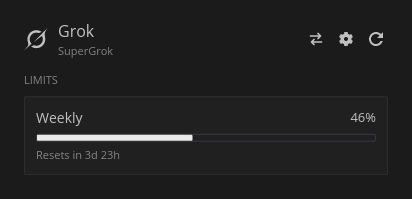
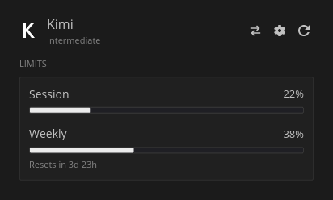
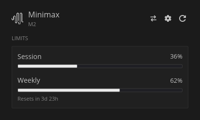
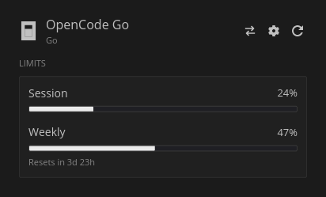
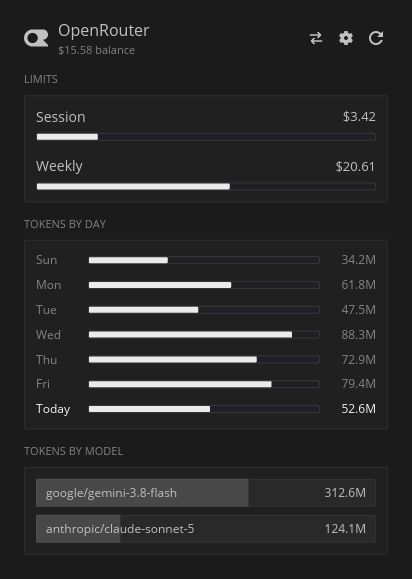
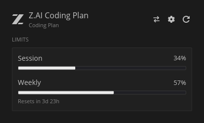
</p>
</details>

**Provider notes**

- **Fish Audio** reads your pay-as-you-go **API credit**, the balance that audio API calls spend. Plus-plan credits only work on the Fish Audio website, so Ledger doesn't show them.

- **OpenRouter** shows spend across all your keys and today's tokens with a management key. A regular key only reports its own spend, and its token history stops at yesterday.

- **Kimi, Minimax, OpenCode Go and Z.AI** forms can be prefilled from OpenCode's `~/.local/share/opencode/auth.json`. Ledger reads that file only when you add an account and never writes to it.

## Credit rings

Turn on **ElevenLabs Credits Ring** or **Fish Credits Ring** under **Settings → PREFERENCES → OPTIONAL**, and that service's credit gauge appears in the header of every other provider. Hover it for the exact balance. With both rings on, the header shows one at a time: click the ring to switch services, and Ledger remembers your choice.

<p align="center">
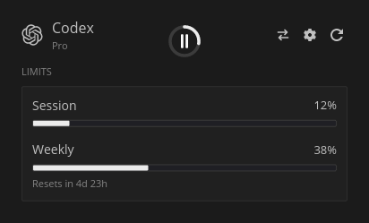

</p>

## Install

### From a release

Download a package from the [latest release](https://github.com/chefn3ff/cosmic-applet-ledger/releases/latest):

```bash
# Debian, Ubuntu, Pop!_OS
sudo apt install ./cosmic-applet-ledger_*_amd64.deb

# Fedora, openSUSE
sudo rpm -i ./cosmic-applet-ledger-*.x86_64.rpm
```

Each release also has a `.tar.gz` with the prebuilt binary, and a `checksums.txt`.

### From source

You need Rust 1.88 or newer, `just`, and the COSMIC build dependencies:

```bash
curl --proto '=https' --tlsv1.2 -sSf https://sh.rustup.rs | sh

sudo apt install -y build-essential pkg-config just libssl-dev \
  libxkbcommon-dev libwayland-dev libfontconfig1-dev libfreetype6-dev libexpat1-dev
```

Then build and install. `just install` installs under `~/.local` and adds Ledger to your panel:

```bash
git clone https://github.com/chefn3ff/cosmic-applet-ledger
cd cosmic-applet-ledger
just install
```

To update, pull and run `just install` again, then `pkill -x cosmic-applet-ledger` so the panel restarts it. Remove Ledger with `just uninstall`.

## Getting started

1. If you installed a package, add Ledger to the panel: **COSMIC Settings → Desktop → Panel → Configure panel applets → Ledger**.

2. Click the panel icon. Providers Ledger detected on your machine already have a page.

   

3. Open **Settings** (the gear). Under **PROVIDERS**, switch on anything that wasn't detected, and click a provider's name to add an account.

   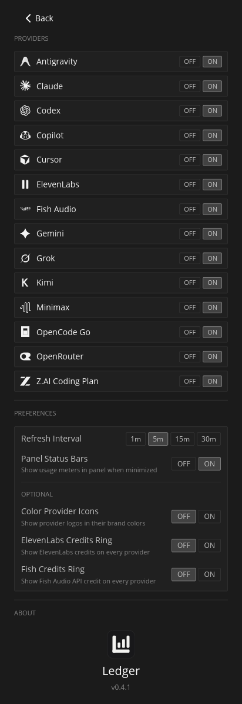
   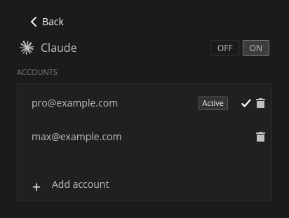

4. Use **⇄** to jump to another provider, and the refresh button to update right away.

   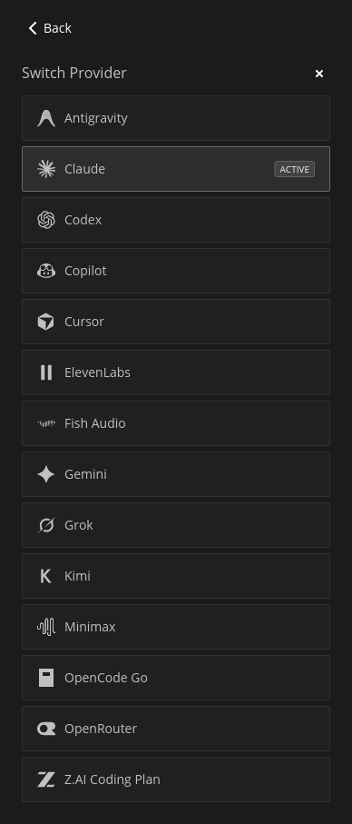

### Settings

- **Refresh Interval**: how often Ledger checks provider APIs, every 1, 5 (default), 15 or 30 minutes.

- **Panel Status Bars**: usage bars in the panel, or just the Ledger icon.

- **OPTIONAL**: the ElevenLabs and Fish credit rings. Each row appears once its provider is on.

## Where your data lives

- **Settings, enabled providers and the account list:**
  `~/.config/cosmic/io.github.chefn3ff.cosmic-applet-ledger/`

- **Ledger's copy of each account's credentials:**
  `~/.local/state/cosmic-applet-ledger/<provider>-accounts/`

- **Daily logs:**
  `~/.local/state/cosmic-applet-ledger/logs/`

Credentials are files only you can read (`0600`, in `0700` folders), written atomically so a crash can't leave a half-written token. Ledger doesn't use a system keyring. Removing an account deletes only Ledger's copy; the provider account and other tools' sign-ins are untouched.

Ledger also reads, and never changes:

- `~/.claude/projects/`: Claude Code session logs, for Claude's token charts.

- `~/.grok/auth.json`: only when you import from the Grok CLI.

- `~/.local/share/opencode/auth.json`: only to prefill account forms.

- The Cursor IDE's local sign-in, when you scan for Cursor accounts.

Logs never contain credentials or tokens. If you find one that does, please [open an issue](https://github.com/chefn3ff/cosmic-applet-ledger/issues).

## Development

```bash
just run-demo      # standalone window with demo accounts for every provider
just screenshots   # regenerate the README screenshots from demo data
cargo test         # unit tests
```

Demo mode (`LEDGER_DEMO=1`) uses made-up accounts and numbers, and never calls a provider API or checks for updates. CI runs `cargo fmt --check`, `cargo clippy -- -D warnings` and `cargo test` on every push; please run them before opening a pull request. Pushing a `v*` tag builds the `.deb`, `.rpm` and tarball and publishes a GitHub release.

## License

Mozilla Public License 2.0, see [LICENSE](LICENSE).

*Original codebase and provider engine: [YapCap](https://github.com/TopiCsarno/yapcap) © Topi Csarno.*
